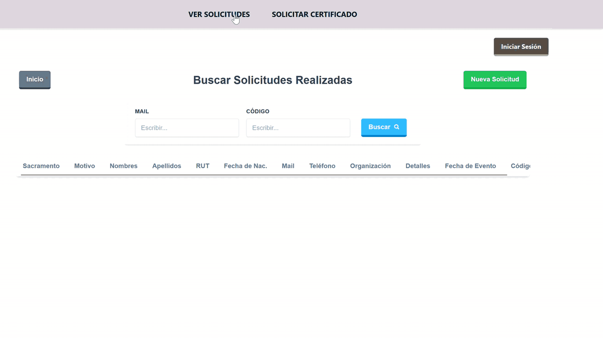

# Zignurat

Digital records management and certificate issuing for parish registries.

Parish records still live in paper books. Zignurat lets people request certificates online, and parishes transcribe each record as they answer a request, digitizing their books one request at a time.



## Roles

The interface is in Spanish.

| Role | Can do |
|---|---|
| Administrador | Manage organizations and members; read every parish's records |
| Organización | Manage its own books, records and members; see requests addressed to it |
| Validador | Everything an organization can, plus issue certificates signed as themselves |
| Usuario | Request certificates and follow their requests |
| Visitor | Request a certificate and look it up with email and reference code |

## Architecture

```
identirat/   Identity service: accounts, roles, password checks (bcrypt), JWT issuance
notariat/    Registry service: organizations, books, baptism records, certificates, requests
utils/       Shared Go module: authentication middleware and sessions
charts/      Helm chart: both services, their PostgreSQL StatefulSets and HTTP routes
k8s/         Cluster-wide setup (GatewayClass)
```

Users log in to Notariat through Identirat. Each service has its own PostgreSQL database.

## Tech stack

- Go, Gin, GORM, PostgreSQL 17
- Server-rendered HTML with htmx, Alpine.js and Tailwind CSS
- PDF generation with gopdf
- Kubernetes (minikube), Helm, Gateway API (Envoy Gateway)

## Running it locally

Requirements: Docker, minikube, kubectl, Helm and openssl. Commands are for bash (Linux, macOS or WSL).

```bash
# 1. Cluster and platform setup (once)
minikube start
helm install eg oci://docker.io/envoyproxy/gateway-helm --version v1.8.1 \
  -n envoy-gateway-system --create-namespace
kubectl apply -f k8s/platform/gatewayclass.yaml

# 2. Secrets (once, never committed)
kubectl create namespace zignurat
kubectl -n zignurat create secret generic zignurat-secrets \
  --from-literal=JWT_SECRET="$(openssl rand -hex 32)" \
  --from-literal=SESSION_SECRET="$(openssl rand -hex 32)" \
  --from-literal=IDENTIRAT_DB_PW="$(openssl rand -hex 16)" \
  --from-literal=NOTARIAT_DB_PW="$(openssl rand -hex 16)" \
  --from-literal=INTERNAL_TOKEN="$(openssl rand -hex 32)"

# 3. Build the images inside minikube and deploy
minikube image build -t zignurat/identirat:local -f identirat/Dockerfile .
minikube image build -t zignurat/notariat:local -f notariat/Dockerfile .
helm install zignurat charts/zignurat -n zignurat \
  --set apps.identirat.tag=local --set apps.notariat.tag=local

# 4. Expose the Gateway (keep it running)
minikube tunnel
```

`minikube tunnel` may ask for your password. Then open:

- Identirat: http://identirat.localhost
- Notariat: http://notariat.localhost

### Demo accounts

Demo data with two fictional parishes is loaded automatically.

| Account | Password | Role |
|---|---|---|
| admin@identirat.com | identiratadmin123 | Administrador (Identirat) |
| admin@notariat.com | notariatadmin123 | Administrador (Notariat) |
| org@notariat.com | notariatorg123 | Organización (Santo Espíritu Sagrado) |
| validator@notariat.com | notariatvalidator123 | Validador (Santo Espíritu Sagrado) |
| user@notariat.com | notariatuser123 | Usuario |

## Roadmap

- Database migrations, run as a Helm hook
- CI: tests, `go vet`, `helm lint`, image build and vulnerability scan
- Small, non-root container images
- Per-validator signatures and per-parish seals, uploaded through the app
- Public certificate verification via QR code
